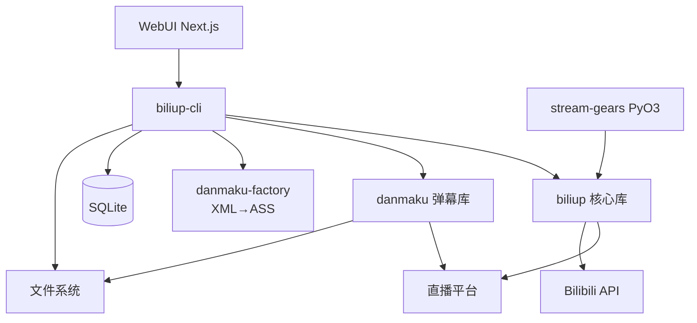

# 系统架构

biliup 采用 **Rust 后端（内嵌 Next.js 前端）+ Python API 绑定** 的架构，各层职责清晰、可独立开发。

> v1.3.0 起 Python 包收敛为**纯 API**：不再提供 `python -m biliup` 入口与录制服务，只保留上传 / 直链下载 / 登录接口。运行完整应用请用原生 CLI、桌面版或 Docker。

---

## 架构总览



各节点详细说明见下方「各层说明」章节。

---

## 各层说明

### 前端层（Next.js + React）

| 项目 | 说明 |
|---|---|
| 技术栈 | Next.js + React 19 + TypeScript + [Semi Design](https://semi.design/)（字节跳动开源组件库） |
| 构建工具 | Next.js（`npm run build`，静态导出到 `out/`） |
| 运行端口 | 开发端口 `3000` / 生产 `19159`（由 Rust 后端托管静态产物） |
| 职责 | 提供 WebUI 管理界面，通过 REST API 与后端通信 |
| 源码位置 | `app/` 目录（主项目） |

开发启动：

```bash
npm i
npm run dev
# 访问 http://localhost:3000
```

> ⚠️ `biliup-cli` 通过 `rust-embed` 内嵌前端产物目录 `out/`，因此在执行 `cargo build` / `cargo test` 之前**必须先跑一次 `npm run build`**，否则编译会因 `out/` 不存在而失败。

### Rust 后端（`crates/`）

| Crate | 说明 |
|---|---|
| `biliup-cli` | 命令行入口 + Web API 服务，整合所有功能 |
| `biliup` | 核心库：直播解析、下载器调度、B站上传 |
| `danmaku` | 弹幕客户端（Rust），支持多平台弹幕录制，输出 XML |
| `danmaku-factory` | 内置的 XML → ASS 转换（原生 Rust，v1.3.0 新增；不再依赖外部 DanmakuFactory 可执行文件） |
| `stream-gears` | PyO3 **基础 API** 绑定（上传 / 直链下载 / 登录），不依赖服务端 |

Rust 后端的优势：
- 高性能：并发下载、上传不阻塞
- 内存安全：无 GC 压力，长时间运行稳定
- 跨平台：提供 Linux / macOS / Windows / Android 预编译二进制

### 下载器类型

源码中支持以下下载器类型：

| 下载器 | 说明 |
|---|---|
| `mesio`（默认） | Rust 原生下载器（rust-srec），无需 FFmpeg |
| `stream-gears` | 上一版本的默认下载器；v1.3.0 起支持 HLS（TS / fMP4），无需 FFmpeg |
| `streamlink` | HLS 多线程下载，需 FFmpeg |
| `ffmpeg` | 通用下载器，需 FFmpeg |
| `sync-downloader` | 边录边传，实时上传 |
| `ytarchive` | 专为 YouTube Live 设计 |
| `ffmpeg-external` | FFmpeg 外部分段模式 |
| `ffmpeg-internal` | FFmpeg 内部分段模式 |
| `yt-dlp` | 使用 yt-dlp 作为后端 |

### Python 包（`crates/stream-gears`）

> v1.3.0 起 Python 包收敛为**纯 API**：`biliup.__main__`、`bili_webup` / `bili_webup_sync` 投稿库、`main_loop` 与 `config_bindings` 均已移除，包体只暴露上传、直链下载与登录接口。录制服务、WebUI、字体与命令行入口都不在 Python 包里。

| 接口 | 说明 |
|---|---|
| `stream_gears.upload` | 上传视频到 B站 |
| `stream_gears.download` | 下载直播流 |
| `stream_gears.download_with_callback` | 带回调的下载 |
| `stream_gears.login_by_cookies` | Cookie 登录 |
| `stream_gears.login_by_web_cookies` | Web Cookie 登录 |
| `stream_gears.get_qrcode` / `login_by_qrcode` | 二维码登录 |
| `stream_gears.send_sms` / `login_by_sms` | 短信登录 |
| `stream_gears.login_by_web_qrcode` | Web 二维码登录 |

Python 包的存在意义：供非 Rust / 非 Node 环境调用上传、下载与登录能力。

### stream-gears PyO3 绑定

`stream_gears` 模块暴露的函数与上表一致，供 Python 脚本直接调用。它只链接 `biliup` 核心库，不再依赖 `biliup-cli` 与 axum。

### 数据层

| 存储 | 说明 |
|---|---|
| SQLite | 从 v0.4.33 起取代配置文件，存储主播列表、上传模板、任务状态、运行日志 |
| 文件系统 | 视频分段（`.flv` / `.mp4` / `.ts`）、弹幕 XML、封面图片、临时缓存 |

> ⚠️ v1.0.0 之前使用 `config.yaml` / `config.toml` 配置文件，升级后首次启动会自动迁移至数据库。

#### 数据库表结构

| 表名 | 说明 |
|---|---|
| `livestreamers` | 直播主播配置 |
| `uploadstreamers` | 上传模板 |
| `streamerinfo` | 录制记录 |
| `filelist` | 录制文件列表 |
| `configuration` | 全局配置和 Cookie 存储 |
| `web_users` | WebUI 登录账号与角色（v1.2.8 新增） |
| `segments` | 录制分段与关键帧索引（v1.2.9 新增） |
| `segment_pins` | 分段引用固定，保护被切片工作台引用的分段不被清理（v1.2.9 新增） |
| `markers` | 看直播时打的标记（v1.2.9 新增） |
| `clips` | 切片与导出记录（v1.2.9 新增） |
| `auto_clip_jobs` | 自动切片任务（v1.2.10 新增，该功能尚未正式发布） |
| `clip_suggestions` | 自动切片候选（v1.2.10 新增，同上） |
| `douyu_cookie_keeper` | 斗鱼 Cookie 自动续期状态（v1.3.0 新增） |
| `stream_session_ids` / `session_group_members` / `session_merge_candidates` | 回看工作台的会话合并（v1.3.0 新增） |
| `render_recipes` / `render_assets` / `render_recipe_assets` / `render_jobs` / `render_sources` / `render_job_assets` | 录后合成的配方、素材与任务（v1.3.0 新增） |
| `upload_observation_tasks` / `upload_observation_files` | 上传队列与活动记录（v1.3.0 新增） |

> 结构以 `crates/biliup-cli/migrations/` 下的迁移文件为准，当前主库共 **15** 个迁移；Fleet 库 `fleet_migrations/` 共 **7** 个。

---

## 请求流转

### 场景一：用户通过 WebUI 添加主播

```
用户操作（浏览器）
  → Next.js 前端
  → POST /v1/streamers（REST API）
  → biliup-cli 处理
  → 写入 SQLite
  → 返回成功
  → 前端刷新主播列表
```

### 场景二：自动录制与上传

```
biliup-cli 定时检测直播间状态
  → 发现开播
  → 调用 biliup 核心库下载直播流
  → 写入文件系统（分段）
  → 下载完成后触发上传任务
  → 调用 biliup-rs 上传至 B站
  → 更新 SQLite 任务状态
  → WebUI 可查看进度
```

### 场景三：命令行直接上传

```
用户执行 biliup upload video.mp4
  → biliup-cli 解析参数
  → 读取 cookies.json（或提示登录）
  → 调用 Bilibili API 上传
  → 输出结果到终端
```

---

## 桌面端

biliup 有两个基于 [Tauri](https://tauri.app/) 的桌面程序，用途不同：

| 形态 | 说明 | 源码 |
|---|---|---|
| **biliup 桌面版** | Tauri v2 外壳，**进程内启动 `biliup server`**，窗口里打开 WebUI；安装包内置 FFmpeg 与 `render-tools/` 字体；版本跟随主项目（当前 `1.3.0`），目前只出 Windows 安装包 | 主仓库 `tauri-app/` |
| **biliup-app** | 独立的 B站投稿 / 稿件管理客户端，不负责录制；独立版本号（`app-v*`），覆盖 Windows / macOS / Linux | [biliup-app-new](https://github.com/biliup/biliup-app-new) 独立仓库 |

> 两种桌面程序都**没有** sidecar 子进程：服务直接跑在桌面进程里。详见[桌面端](/guide/getting-started/更多/desktop-app.html)。

---

## 跨平台支持

| 平台 | 架构 | 说明 |
|---|---|---|
| Windows | x86_64 | 预编译二进制 + biliup 桌面版安装包 |
| Linux | x86_64 / aarch64 | 预编译二进制 |
| macOS | x86_64 / aarch64 | 预编译二进制 |
| Android (Termux) | aarch64 | 通过交叉编译 `aarch64-linux-android` 目标支持 |

---

## 技术栈版本要求

| 组件 | 最低版本 | 推荐版本 |
|---|---|---|
| Rust（编译 CLI） | 1.85 | stable |
| Node.js（前端开发） | 20.9 | 22 LTS |
| Python（Python API 绑定） | 3.9 | 3.12 |
| npm | 9 | 10 |
| maturin（Python/Rust 桥接） | 1.0 | latest |

> Node.js 20.9 是 Next.js 16 的最低要求；若只使用 npm 分发的 CLI（`@biliup/cli`），Node.js 18+ 即可。

---

## 项目目录结构（主仓库）

```
biliup/
├── crates/              # Rust 工作区成员
│   ├── biliup/          # 核心：直播解析、下载、上传
│   ├── biliup-cli/      # 命令行与 Web API
│   ├── danmaku/         # 弹幕客户端
│   ├── danmaku-factory/ # 内置 XML→ASS 转换
│   └── stream-gears/    # PyO3 基础 API 绑定（不含服务端）
├── app/                 # Next.js 前端（WebUI）
├── npm/                 # npm 分发的包装包（@biliup/cli 等）
├── public/              # 前端静态资源
├── tauri-app/           # biliup 桌面版外壳（Windows 安装包）
├── docs/                # 文档源文件
├── Cargo.toml           # Rust 工作区配置
├── package.json         # 前端依赖与构建脚本
└── tsconfig.json
```

> 📦 WebUI 源码在主仓库的 `app/`；主仓库的 `tauri-app/` 是 **biliup 桌面版**外壳（内置服务与 FFmpeg），投稿客户端 **biliup-app** 在[独立仓库](https://github.com/biliup/biliup-app-new)维护。

---

## 延伸阅读

- [开发指南（前端）](/guide/开发指南/frontend.html)
- [开发指南（Python）](/guide/开发指南/python.html)
- [开发指南（Rust CLI）](/guide/开发指南/rust-cli.html)
- [REST API 文档](/guide/api/rest-api.html)
